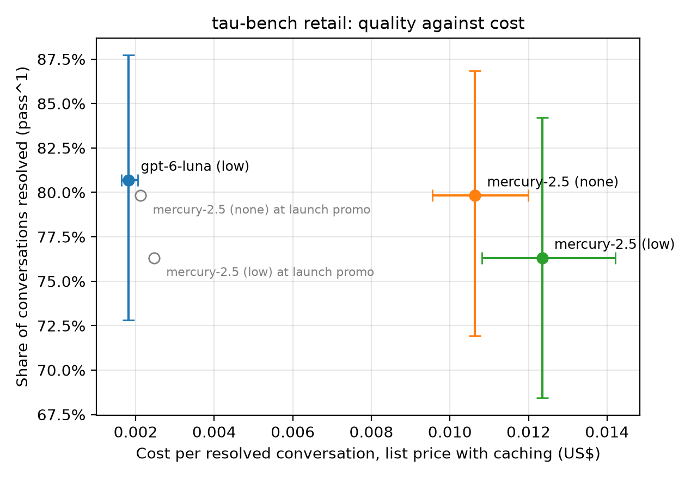

# What a support team pays for Mercury's speed, and what would change it

Srishti Samadder, October 2026

I put Mercury 2.5 through a public customer-support benchmark to find out what its speed costs a support team per resolved ticket, with OpenAI's GPT-6 Luna as the comparison. Inception sells Mercury on speed, and until September its price list said cheaper too. On 22 September OpenAI released Luna at half Mercury's list price, which changed what a buyer compares. A support team does not buy tokens; it buys resolved tickets and cares how long customers wait. So that is what I measured: 114 scripted support conversations per model, scored against Sierra's answer key, at list prices, on Inception's free tier. It took about ten dollars and a weekend.

Mercury resolved as many conversations as Luna and replied in less than half the time. At list price it cost about six times as much per resolved conversation: a cent against a fifth of a cent. At Mercury's launch price the two are within 20%.

The gap is not mostly the model. About half of it is the effective price of input tokens, split between Mercury's list price and a 71% cache hit rate against OpenAI's 95%. About a quarter is that Mercury writes 1.8 times as much visible text, and every word gets fed back in on the next turn. A tenth was reasoning tokens that the `low` setting did not remove; turning reasoning off made Mercury 16% faster and 14% cheaper with no measured loss in quality.

One thing to hold in mind throughout: this ran on Inception's free tier. The rate limits I hit were certainly a tier effect. The cache hit rate and the latency might be too, if free-tier traffic shares capacity or a cache that evicts sooner. Every one of those would make Mercury look worse than a paying customer sees, not better, so the speed figure is a floor and the cost gap may be narrower on a paid tier. Everything below rests on that one run, and a paid-tier run could change my reading of it.

If I were on the team, the order I would look at these in: lift the cache hit rate, make a lighter reasoning budget the default for tool-calling workloads, fix what a developer meets on the free tier in week one, and sell the speed as a priced premium rather than as cheaper. Everything here can be rerun for about five dollars; see [How it was run](#how-it-was-run).

It is one workload on one weekend. I am sure there are other things worth looking at, and I would be glad to help with those too.

## Why I ran this

Inception's pitch is speed, and until September the price list said cheaper too. On 22 September OpenAI released GPT-6 Luna at $0.10 per million input tokens and $0.50 output, half Mercury 2.5's list price. For anyone comparing price lists, that left speed carrying the whole sale.

A support team deciding whether to try Mercury does not buy tokens. It buys resolved tickets, and it cares how long customers wait. So the question was: for the most common agentic workload, does quality hold, how much faster is it really, and what premium does the speed cost per resolved conversation? I could not find that published for Mercury 2.5, so I measured it.

## What I measured

[tau2-bench](https://github.com/sierra-research/tau2-bench) is Sierra's open benchmark for customer-support agents. Its retail set has 114 scenarios. In each, a scripted customer has a problem, and the model under test acts as the support agent, with tools to look up users and orders, exchange items and issue refunds, under a written store policy. A conversation counts as resolved only when the store's database ends up in the state Sierra's answer key requires and, in 40 scenarios, a grader confirms the agent told the customer the facts it had to. The answer key is Sierra's, so nothing I chose decides who wins.

| | Setting |
|---|---|
| Harness | tau2-bench, commit recorded in each results file under `info.git_commit` (`96a3ef9`, 15 Oct 2026) |
| Models | `mercury-2.5` on Inception's API, free tier; `gpt-6-luna` on OpenAI's Responses API |
| Reasoning | `low` for both; a third run of Mercury with `none` |
| Customer simulator | `gpt-4.1-2025-04-14` at temperature 0, the benchmark's default, the same for every run |
| Scenarios | all 114 retail scenarios, one conversation each, one at a time |
| Prices | list prices from each vendor's page on 18 Oct 2026, in `prices.json`; cached input billed at each vendor's cached rate using the cache counts the vendor reported |
| Latency | seconds per agent reply, measured from a laptop in California, network time included |

Both models have a reasoning setting that controls how much hidden thinking they do before each reply. I set both to `low` so they matched. Luna's `low` turned out to be almost no reasoning and Mercury's turned out to be heavy, so I ran Mercury a second time with reasoning off. The tables below show all three.

Three numbers come out per model: the share of conversations resolved, the seconds a customer waits per reply, and the dollars of model spend per resolved conversation (all spend, failed conversations included, divided by the number resolved).

## Biases and limits

- Free tier. Rate limits were certainly a tier effect. Cache hit rate and latency might be. Every one of these would make Mercury look worse than a paying customer sees, never better, so the 2.3-fold speed figure is a floor.
- One run, one domain. Sierra's airline and telecom sets would add 164 scenarios for about five dollars.
- The customer and the grader are OpenAI models. That is the benchmark's default and what every published tau-bench number uses.
- Luna ran on OpenAI's Responses API because the chat endpoint refuses a reasoning setting when tools are present. Mercury ran on chat completions. Both received the same setting; I checked the request bodies.
- Latency includes network time from a laptop, and the models ran at different times of day. Both were measured the same way.

## What a buyer sees

| | GPT-6 Luna, reasoning low | Mercury 2.5, reasoning off | Mercury 2.5, reasoning low |
|---|---|---|---|
| Conversations resolved, of 114 | 92 (80.7%) | 91 (79.8%) | 87 (76.3%) |
| Median seconds per reply | 1.87 | 0.80 | 0.95 |
| Slowest 5% of replies, seconds | 3.67 | 1.49 | 1.97 |
| Model time per conversation, median seconds | 25.6 | 11.2 | 13.3 |
| $ per resolved conversation, list price with caching | $0.0018 | $0.0106 | $0.0123 |
| $ per resolved conversation, list price, no caching | $0.0091 | $0.0261 | $0.0286 |
| $ per resolved conversation, launch price with caching | | $0.0021 | $0.0025 |



The paired difference in resolution rate between Mercury with reasoning off and Luna is 0.9 points in Luna's favour, with a 95% range of 9.6 points either way. One run of 114 scenarios cannot separate models closer than about 10 points, so the claim is no detectable difference, not parity. The two models fail on different scenarios: 75 were solved by both, 17 by Luna only, 12 by Mercury only and 10 by neither. The speed and cost differences are far outside the noise. Full tables are in `out/summary.md`.

In absolute terms both models cost about a cent or less per resolved conversation. The buyer's question is not which model is cheaper. It is whether twelve seconds less waiting per conversation is worth about a cent.

## Why the gap exists

| Per agent reply | GPT-6 Luna | Mercury 2.5 | What it means |
|---|---|---|---|
| Input tokens | 5,351 | 7,210 | Mercury's longer replies get fed back in every turn |
| Share of input served from cache | 95% | 71% | Both vendors bill cached input at a tenth of the price |
| Effective input price, $ per million | 0.015 | 0.074 | List price times cache rate: a five-fold gap on three-quarters of the bill |
| Output tokens | 68 | 208 | |
| of which reasoning | 15 | 111 | Both set to `low`; Mercury's `low` is seven times heavier |
| Visible text, characters | 130 | 236 | Mercury writes 1.8 times as much |
| Characters per visible token | 3.05 | 2.74 | Mercury's tokenizer counts about 11% more tokens for the same text |
| Output tokens per second, wall clock | 33 | 193 | Mercury's raw speed edge is about six-fold |

Roughly: half of the gap is effective input price, in about equal parts list price and cache hit rate. A quarter is verbosity compounding through the input. A tenth is reasoning tokens. The rest is the tokenizer. (`why_tokens.py` prints this table from the results.)

If Mercury cached at OpenAI's 95%, its effective input price would fall from $0.074 to about $0.029 per million, and the overall gap from about six-fold to about three-and-a-half. Inception's docs say caching is automatic but do not state how long a cached prefix lives or the minimum length cached. I also cannot rule out that the free tier's cache behaves differently from a paid one; that is the first thing I would check.

With reasoning off, Mercury resolved 91 conversations against 87 with `low`, inside the noise, while replying 16% faster and costing 14% less per resolved conversation. Inception honours the setting; `low` is simply heavy.

Underneath all of it is the shape of the workload. A support turn feeds in 5,000 to 7,000 tokens and gets back 70 to 200. Diffusion's advantage is in generating output; reading the input and the network round trip are costs both models pay in full. Mercury produced tokens six times faster than Luna by the wall clock but spent much of that writing three times as many, so the customer saw a 2.3-fold gain.

## What I would look at first

| | Lever | Owner | What it would do |
|---|---|---|---|
| 1 | Cache hit rate from 71% toward 95% | Infrastructure | Closes close to half the cost gap on its own |
| 2 | A lighter default reasoning budget for tool-calling workloads, and document `none` | Product, docs | 16% faster, 14% cheaper, no measured quality loss |
| 3 | What a developer meets on the free tier in week one | Developer experience | See the log below |
| 4 | Sell the speed as a priced premium | Go-to-market | "Twelve seconds less waiting per conversation for about a cent" is a sentence a support lead can take to a budget owner |
| 5 | A terser default style for agent use | Model, prompting | A quarter of the gap, but it needs testing against resolution rate |

This is an outsider's ordering. I would expect to be wrong about effort and right about the order of the first two.

## The pricing question when the launch price ends

At the launch price, Mercury with reasoning off costs $0.0021 per resolved conversation against Luna's $0.0018, close enough that speed wins the comparison. At list price it costs $0.0106, and no amount of speed closes that for a buyer who is counting. So the launch price is not a discount on this workload. It is the price at which Mercury is competitive per resolved conversation.

That makes the end of the promotion a product decision rather than a finance one. The options I can see from outside: keep a permanent low tier for high-volume agentic workloads; price on what the buyer actually values, such as a latency commitment; or accept premium positioning and sell to the teams for whom the twelve seconds is worth more than a cent. Each needs a different story in the sales deck, and the data here is how I would start modelling which one holds.

## Where I would look next

The same method on workloads whose shape favours diffusion: long outputs, latency that the user feels directly, streaming. Voice and code editing are exactly those shapes, and Inception already ships Mercury Voice and Mercury Edit. The numbers here say why that lineup is right. They also say the general-purpose chat API needs a different story from "cheaper and faster", because on an input-heavy workload most of the raw speed never reaches the customer.

Two other things I would want to measure before deciding anything:

- The same 114 scenarios on a paid tier, to see how much of the latency, the cache hit rate and the rate limiting is the tier rather than the product.
- Mercury against the other models a support team would shortlist at this price, Gemini Flash-Lite and Claude Haiku, which the scripts already support.

And one thing I would publish. Token prices mislead in both directions: tokenizers differ by 10%, reasoning tokens hide inside output, and cache hit rates differ by 25 points between vendors. Cost per resolved conversation and customer wait per conversation, on a public benchmark, are the two numbers that survive all of that. If Inception published them for its own models, with the method, it would set the terms buyers compare on.

## Things I would log

| What happened | Where | Why it matters |
|---|---|---|
| Four conversations at once hit the rate limit on every request. At one at a time, 58 of 114 conversations still got a 429 at some point. The console shows 1,000 requests and 1M input tokens a minute; the run used roughly 20 requests and 150k tokens a minute | Free tier | Either the enforced limit differs from the displayed one or enforcement is finer than per-minute |
| Caching works and is reported, but the docs do not say how long a prefix lives or the minimum length cached | Docs | A developer cannot structure prompts to hit the cache |
| `reasoning_effort: low` uses about 110 tokens a reply, seven times Luna's `low`. `none` works and is not documented for Mercury 2.5 | Docs, defaults | The difference between 0.95 and 0.80 seconds a reply |
| Three conversations ended with an empty reply, no text and no tool call. Once the text began "838 the user details" | Model | Agent frameworks crash on an empty reply. The benchmark drops these as infrastructure errors; I counted them as failures |
| One request in 342 came back as an HTTP 400 whose body was a chat refusal: "I'm not able to share my instructions or configuration." Three reruns of the same scenario passed | API | A guardrail returning conversational text as an error |
| LiteLLM has no price entry for Mercury and reports its cost as $0.00 | Ecosystem | Every cost dashboard built on it shows Mercury as free |

## How it was run

Two choices in the method matter. The benchmark labels any exception an infrastructure error, retries it and leaves it out of the pass rate; that includes a model returning something the harness cannot parse. Here the harness's retries are off (`--max-retries 0`), every error is recorded in `runs/*.errors.json` before anything reruns, errors caused by the agent model count as failures, and only network, grader and customer-simulator errors are retried. A scenario that still fails for a non-model reason is dropped for every model, so they are always compared on the same scenarios. And cost is recomputed from the token and cache counts each vendor returned on every reply, at the prices in `prices.json`, because LiteLLM prices Mercury at zero.

| File | What it does |
|---|---|
| `run_pilot.sh` | Runs both models; `smoke` for 10 scenarios, `pilot` for all 114. `REASONING=none ARMS=mercury` adds the third arm |
| `record_errors.py` | Records every error and its cause before any rerun; called by the run script |
| `analyze.py` | The tables, the paired comparisons, the chart, and five failures per model to read |
| `why_tokens.py` | Where each model's tokens went: text, reasoning, cache, tokenizer |
| `read_failure.py` | Prints one conversation with the answer key, to see why it failed |
| `estimate_cost.py` | Projects the cost of the full run from a smoke test |
| `check_secrets.py` | Confirms no API key is in the folder before a commit |
| `prices.json` | Every price used, with the date checked |
| `runs/` | Raw results for every conversation, and the error record |
| `out/` | Generated tables and chart |

To reproduce, with [uv](https://docs.astral.sh/uv/) installed and the harness cloned at `~/tau2-bench`:

```bash
# in ~/tau2-bench
uv sync
uv pip install websockets
# .env needs OPENAI_API_KEY, LITELLM_PROXY_API_BASE=https://api.inceptionlabs.ai/v1, LITELLM_PROXY_API_KEY=<Inception key>

# in this folder
CONCURRENCY=1 bash run_pilot.sh smoke                      # 10 scenarios per model, checks setup
uv run python estimate_cost.py runs/smoke_*.json
CONCURRENCY=1 bash run_pilot.sh pilot                      # 114 scenarios per model
REASONING=none ARMS=mercury CONCURRENCY=1 bash run_pilot.sh pilot
uv run --with matplotlib python analyze.py runs/pilot_*.json
uv run python why_tokens.py runs/pilot_*.json
```

To recompute every table from the committed results without any API keys, run only the last two lines.
